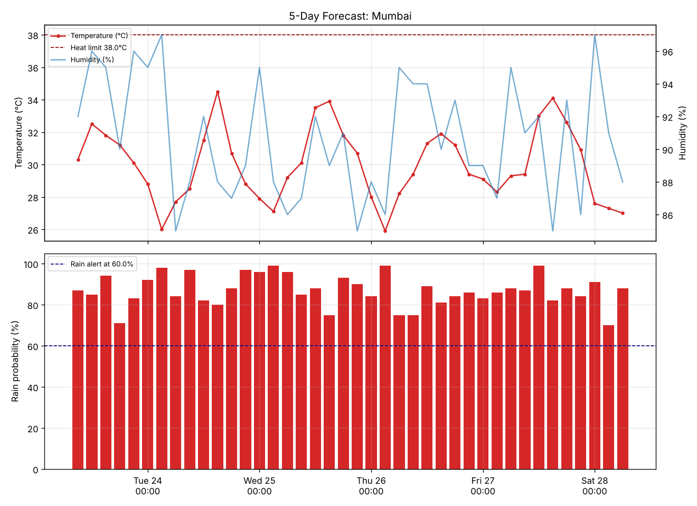

# 🌦️ Weather Forecast & Alert Application

A beginner-friendly, industry-style Python project that fetches current weather and a 5-day forecast, analyses it with Pandas, raises **rain / heat / cold / wind / humidity / storm / AQI alerts**, draws charts, saves CSV + text reports, and (optionally) shows everything in a **Streamlit dashboard** or sends an **email alert**.

It runs in two modes:
- **API mode**: live data from OpenWeatherMap (free key).
- **Simulation mode**: built-in virtual weather data, no internet or key needed.

## Problem Statement
People, farmers, travellers, logistics teams and event planners need timely warning of bad weather. Raw weather JSON is hard to read, so this project turns it into clear alerts and reports.

## Industry Relevance
| Who | How they use it |
|---|---|
| Farmers | Rain/heat alerts for irrigation and harvesting |
| Logistics | Storm/wind alerts for route planning |
| Event planners | Rain probability for outdoor events |
| Travellers | Packing and safety decisions |

## Features
- City input (interactive or `--city`)
- Live API integration with friendly error handling (bad key, city not found, no internet, timeouts)
- Current weather, 5-day / 3-hour forecast, optional AQI
- Pandas daily summary and statistics
- Configurable thresholds with severity levels (INFO / WARNING / CRITICAL)
- Charts: temperature, humidity, rain probability, alerts by severity
- Reports: CSV (forecast, daily summary, alerts), JSON, text report
- Virtual simulation with scenarios: `normal, heatwave, storm, humid, polluted, cold`
- Optional email notification and Streamlit dashboard (with map)
- Unit tests

## Tech Stack
Python 3.9+, requests, pandas, matplotlib, python-dotenv, streamlit, smtplib, unittest.

## Folder Structure
```
Weather-Forecast-Alert-Application/
├── data/            sample weather JSON (API format)
├── src/             config, weather_api, simulation, parser, analyzer, alerts,
│                    visualizer, report, notifier, pipeline
├── outputs/         generated CSV / JSON files
├── images/          generated charts + screenshots
├── reports/         generated text reports
├── docs/            step-by-step guides (explanations, plan, GitHub, interview)
├── tests/           unit tests
├── dashboard.py     Streamlit dashboard
├── main.py          command-line app
├── requirements.txt
├── .env.example
└── .gitignore
```

## API Setup
1. Create a free account at https://openweathermap.org/api and copy your API key.
2. `cp .env.example .env` (Windows: `copy .env.example .env`).
3. Open `.env` and set `OPENWEATHER_API_KEY=your_key`.
4. New keys can take up to ~2 hours to activate. Never commit `.env`.

## How to Run
```bash
python -m venv venv
source venv/bin/activate          # Windows: venv\Scripts\activate
pip install -r requirements.txt

# Simulation mode (no key needed)
python main.py --mode simulation --city Varanasi
python main.py --mode simulation --city Mumbai --scenario storm
python main.py --mode simulation --city Delhi --scenario heatwave --heat 40

# Live API mode
python main.py --mode api --city London

# Dashboard
streamlit run dashboard.py

# Tests
python -m unittest discover tests
```
Useful flags: `--heat --cold --humidity --wind --rain-prob --no-chart --email`.

## Sample Output
```
==============================================================
 WEATHER FORECAST & ALERT REPORT - Mumbai, IN
==============================================================
CURRENT WEATHER
  Condition   : Thunderstorm (thunderstorm with heavy rain)
  Temperature : 28.1°C   Humidity: 95%   Wind: 17.3 m/s
ALERTS (7)
  [CRITICAL] WIND     Now: Strong wind 17.3 m/s (limit 10.0 m/s). Secure loose objects.
  [CRITICAL] STORM    Now: Storm conditions: thunderstorm with heavy rain. Stay indoors.
  [CRITICAL] RAIN     Tue 24 Nov 00:00: Heavy rain expected: 12.4 mm in 3h
```

## Screenshots
Add yours to `images/` and link them here:
```



```

## Learning Outcomes
REST API integration, JSON parsing, Pandas aggregation, rule-based alert logic, Matplotlib charts, environment-variable security, error handling, modular design, CLI building, unit testing, Git/GitHub workflow.

## Future Improvements
SMS (Twilio), Telegram bot, scheduled runs (cron / Task Scheduler), database storage, multi-city comparison, Docker.

## License
MIT. For learning and portfolio use.
